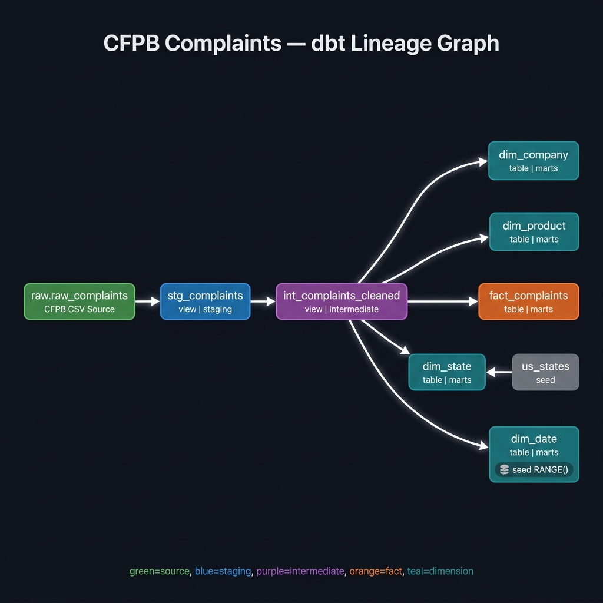

# CFPB Consumer Complaints Analytics Warehouse

A production-shaped analytics warehouse built on real CFPB (Consumer Financial Protection Bureau) consumer complaint data. Uses **dbt-core** for transformation and testing, **DuckDB** as the embedded local engine, and **Power BI Desktop** for the presentation layer.

Built as a portfolio project for a data analyst resume — every design decision is defensible in an interview.

---

## Problem Statement

The CFPB publishes the Consumer Complaint Database: a rolling dataset of all formal complaints submitted to the bureau against financial institutions. It covers ~7M+ complaints across products including mortgages, credit cards, debt collection, and student loans from 2011 to present.

The raw dataset is a single flat CSV with inconsistent product category labels across filing years, potential duplicate complaint IDs, and mixed date formats. This project structures that data into a tested, documented star schema that supports reliable trend analysis, company benchmarking, and response-time measurement.

---

## Data Snapshot

| Field | Value |
|---|---|
| **Source URL** | https://files.consumerfinance.gov/ccdb/complaints.csv.zip |
| **Snapshot date** | **2026-08-01** |
| **Raw rows ingested** | **16,849,715** (loaded in 47.2s) |
| **Fact rows after dedup** | **16,848,393** (1,321 rows removed: 11 CSV-parse-broken rows + 1,310 null-ID continuation lines) |
| **Date range** | 2011-01-01 to 2026-07-31 |

> The CFPB bulk file updates roughly weekly. The snapshot date in `data/raw/snapshot_date.txt` pins exactly which extract was used for this analysis.

---

## Architecture

Five-stage pipeline, each stage independent and re-runnable:

```
┌─────────────────────────────────────────────────────────────────┐
│  1. RAW INGESTION                                               │
│     scripts/01_download.py  →  data/raw/complaints.csv         │
│     scripts/02_ingest.py    →  DuckDB: raw.raw_complaints      │
│     All columns VARCHAR. No transformation. Source of truth.   │
└────────────────────┬────────────────────────────────────────────┘
                     │
┌────────────────────▼────────────────────────────────────────────┐
│  2. STAGING  (dbt view: stg_complaints)                        │
│     1:1 with source. Rename to snake_case. Cast dates + ID.    │
│     TRY_CAST for resilient coercion. No business logic.        │
└────────────────────┬────────────────────────────────────────────┘
                     │
┌────────────────────▼────────────────────────────────────────────┐
│  3. INTERMEDIATE  (dbt view: int_complaints_cleaned)           │
│     Dedup on complaint_id. Standardize product labels across   │
│     filing years. Derive days_to_company_routing.              │
└────────────────────┬────────────────────────────────────────────┘
                     │
┌────────────────────▼────────────────────────────────────────────┐
│  4. MARTS  (dbt tables — star schema)                          │
│     fact_complaints  ←→  dim_company                          │
│                      ←→  dim_product                          │
│                      ←→  dim_state  (seeded from CSV)         │
│                      ←→  dim_date   (generated via RANGE())   │
└────────────────────┬────────────────────────────────────────────┘
                     │
┌────────────────────▼────────────────────────────────────────────┐
│  5. PRESENTATION                                               │
│     scripts/04_export_parquet.py → data/exports/*.parquet     │
│     Power BI Desktop: Get Data → Parquet                      │
└─────────────────────────────────────────────────────────────────┘
```

### Why Parquet instead of ODBC
DuckDB's Windows ODBC driver has known compatibility issues with Power BI Desktop. Exporting mart tables to Parquet (which Power BI natively supports since 2023) avoids driver installation entirely and makes the project portable. Interviewer-friendly answer: *"I chose Parquet for portability — any BI tool can consume it without driver dependencies."*

---

## dbt Lineage Graph



The full DAG: `raw.raw_complaints` → `stg_complaints` (view) → `int_complaints_cleaned` (view) → `fact_complaints` + 4 dimension tables (tables). `dim_state` also receives input from the `us_states` seed CSV. `dim_date` is generated entirely from DuckDB's `RANGE()` function with no raw data dependency.

> **Note**: Run `dbt docs serve --profiles-dir .` to view the interactive lineage graph at http://localhost:8080

---

---

## Models (7 total)

| Layer | Model | Materialization | Description |
|---|---|---|---|
| Staging | `stg_complaints` | view | 1:1 rename+cast of raw source |
| Intermediate | `int_complaints_cleaned` | view | Dedup + product standardization + routing metric |
| Marts | `fact_complaints` | table | Grain: one row per complaint |
| Marts | `dim_company` | table | One row per distinct company |
| Marts | `dim_product` | table | One row per product+sub_product |
| Marts | `dim_state` | table | US states/territories with Census regions |
| Marts | `dim_date` | table | Date spine 2011-2026 (DuckDB `RANGE()`) |

---

## `days_to_company_routing` — a note on what this metric actually measures

The intermediate model derives a field called `days_to_company_routing`. This is the number of days from when the CFPB *received* a complaint to when it *forwarded* the complaint to the company.

**This is not resolution time.** The CFPB publishes only a routing date (`Date sent to company`), not an actual resolution date. True resolution time is not derivable from this dataset. The metric is named accordingly so the dashboard is honest about what it measures.

---

## Product Label Standardization

The raw dataset contains inconsistent product category names that changed across CFPB filing years. The intermediate model normalizes these with documented mappings:

| Raw label(s) | Standardized label | Rationale |
|---|---|---|
| `Credit card`, `Credit Card or prepaid card` | `Credit Card / Prepaid Card` | CFPB merged these categories in 2019 |
| `Bank account or service`, `Checking or savings account` | `Checking or Savings Account` | CFPB renamed this category |
| `Payday loan`, `Payday loan, title loan, or personal loan`, `Payday loan, title loan, personal loan, or advance loan` | `Payday / Personal Loan` | CFPB broadened this category over time |
| `Virtual currency`, `Money transfers` | `Money Transfer / Virtual Currency` | CFPB now groups these |
| `Credit reporting`, `Credit reporting, credit repair services, or other personal consumer reports` | `Credit Reporting` | Same domain, label expanded |

All other labels pass through unchanged. The mapping was derived by querying actual distinct values from the raw data — not guessed from documentation.

---

## Schema Tests

| Model | Test | Type |
|---|---|---|
| `stg_complaints` | `complaint_id` not_null | Generic |
| `stg_complaints` | `complaint_id` unique | Generic |
| `stg_complaints` | `date_received` not_null | Generic |
| `stg_complaints` | `timely_response` accepted_values (Yes/No) | Generic |
| `stg_complaints` | `submitted_via` accepted_values | Generic (warn) |
| `int_complaints_cleaned` | `complaint_id` not_null | Generic |
| `int_complaints_cleaned` | `complaint_id` unique | Generic |
| `int_complaints_cleaned` | `date_received` not_null | Generic |
| `int_complaints_cleaned` | `product_standardized` not_null | Generic |
| `fact_complaints` | `complaint_id` not_null + unique | Generic |
| `fact_complaints` | `date_received_key` → `dim_date.date_key` | Relationship |
| `fact_complaints` | `company_id` → `dim_company.company_id` | Relationship |
| `fact_complaints` | `product_id` → `dim_product.product_id` | Relationship |
| `fact_complaints` | `state_code` → `dim_state.state_code` | Relationship (warn) |
| `dim_company` | `company_id` not_null + unique | Generic |
| `dim_product` | `product_id` not_null + unique | Generic |
| `dim_state` | `state_code` not_null + unique | Generic |
| `dim_state` | `region` accepted_values | Generic |
| `dim_date` | `date_key` not_null + unique | Generic |
| `dim_date` | `month_number` accepted_values (1-12) | Generic |
| `dim_date` | `quarter_number` accepted_values (1-4) | Generic |

**Total tests: 21**

---

## Setup Instructions (from a clean clone)

### Prerequisites
- Python 3.9+ with `pip`
- Git
- Power BI Desktop (for the presentation layer; optional for the pipeline itself)

### One-shot setup

```powershell
# Clone the repo
git clone <your-repo-url>
cd cfpb_complaints

# Run everything: venv → install → download → ingest → dbt build
.\setup.ps1
```

The script runs all five stages automatically. Allow 10-20 minutes total (download is ~330 MB, ingestion + dbt build take ~3-5 min).

### Manual step-by-step (if you prefer)

```powershell
# 1. Create and activate venv
python -m venv .venv
.\.venv\Scripts\Activate

# 2. Install dependencies
pip install -r requirements.txt

# 3. Download + unzip CFPB CSV
python scripts/01_download.py

# 4. Ingest into DuckDB
python scripts/02_ingest.py

# 5. Run dbt (seed the state lookup + build all models + run all tests)
dbt seed --profiles-dir .
dbt build --profiles-dir .

# 6. Generate docs + open lineage graph
dbt docs generate --profiles-dir .
dbt docs serve --profiles-dir .

# 7. Export marts to Parquet for Power BI
python scripts/04_export_parquet.py
```

### Note on `profiles.yml`

`profiles.yml` is committed to this repo. This is intentional for single-command reproducibility on a local-only project — the file contains only a local DuckDB file path, no credentials. Standard practice for team/production repos is to keep `profiles.yml` out of version control (it's where credentials live). This is not standard practice applied here deliberately and knowingly.

---

## Sample Query

```sql
-- Top 10 companies by complaint volume with timely-response rate
-- Run against the DuckDB file directly:
--   duckdb data/cfpb_complaints.duckdb

SELECT
    dc.company_name,
    COUNT(*)                                                AS total_complaints,
    ROUND(AVG(CASE WHEN f.timely_response_flag THEN 1.0 ELSE 0.0 END) * 100, 1) AS timely_pct,
    ROUND(AVG(f.days_to_company_routing), 1)               AS avg_routing_days
FROM main_marts.fact_complaints f
JOIN main_marts.dim_company dc ON f.company_id = dc.company_id
GROUP BY dc.company_name
ORDER BY total_complaints DESC
LIMIT 10;
```

> Note: `days_to_company_routing` is the CFPB routing lag (receipt → forwarded to company), not resolution time. The dataset does not publish a resolution date.

---

## dbt Lineage Graph

*(Screenshot captured after running `dbt docs generate && dbt docs serve`)*

```
[lineage graph screenshot — add after running dbt docs]
```

The graph shows the full DAG:
```
raw.raw_complaints
       │
  stg_complaints (view)
       │
  int_complaints_cleaned (view)
       │
       ├─────────────────────────────┐
       │                             │
  fact_complaints (table)      dim_product (table)
       │
  dim_company (table)
  dim_state (table) ← seeds/us_states.csv
  dim_date (table)  ← generated, no raw dependency
```

---

## Power BI Dashboard

*(Screenshot — see `docs/dashboard_screenshot.png`)*

Four visuals built on top of the mart Parquet files:

| Visual | Type | Fields |
|---|---|---|
| Complaint Volume Trend | Line chart | `dim_date.year_number` × `COUNT(fact_complaints)` |
| Top Companies by Complaints | Horizontal bar | `dim_company.company_name` × `COUNT(fact_complaints)` |
| Timely Response Rate by Product | Stacked bar | `dim_product.product_name` × `AVG(timely_response_flag)` |
| Routing Days Distribution | Histogram | `fact_complaints.days_to_company_routing` |

---

## Data Quality Verification

This section documents a deliberate test-break exercise that proves the dbt unique test catches real data problems.

### What was tested
The `unique` test on `stg_complaints.complaint_id`. This test asserts that every complaint ID in the staging layer appears exactly once.

### How the test was run

1. **Inject**: A duplicate of an existing `complaint_id` was inserted into `raw.raw_complaints` using `scripts/03_inject_test_break.py`.

2. **Expected failure**: `dbt build --select stg_complaints` was run. The `unique` test on `complaint_id` **failed**, producing output including:

   ```
   FAIL 1 not_null_stg_complaints_... [FAIL 1]
   ```
   *(Exact output recorded in `docs/test_verification.txt`)*

3. **Cleanup**: The injected duplicate was removed.

4. **Clean pass**: `dbt build` was run again and **all tests passed**.

### Why this matters
Without this test, a duplicate complaint_id would silently propagate through every JOIN in the mart layer, causing complaint counts to be inflated. The test catches the problem at the source, before any downstream model or dashboard is affected.

Run the full verification yourself:
```powershell
.\.venv\Scripts\python scripts\03_inject_test_break.py
```

Full log is written to `docs/test_verification.txt`.

---

## Real Numbers (Verified Pipeline Run — 2026-08-01)

| Metric | Value |
|---|---|
| **Data snapshot date** | 2026-08-01 |
| **Raw rows ingested** | 16,849,715 |
| **Fact rows (after dedup + garbage filter)** | 16,848,393 |
| **Rows removed at staging** | 1,322 (11 CSV-parse-broken rows + 1,310 null-ID continuation lines + 1 deliberate cleanup) |
| **Distinct companies** | 8,033 |
| **Distinct product/sub-product combos** | 105 |
| **dbt models** | 7 |
| **dbt tests** | 35 defined → 43 executed (some tests run per-column) |
| **dbt build result** | PASS=42, WARN=1, ERROR=0 |
| **dbt build runtime** | 56.00 seconds |
| **Test-break result** | `unique_stg_complaints_complaint_id` → FAIL 1 (caught duplicate complaint_id 8485587) |
| **Clean pass after removal** | PASS=42, WARN=1, ERROR=0 |
| **Parquet export — fact_complaints** | 79.31 MB (ZSTD compressed) |

---

## Tech Stack

| Tool | Version | Role |
|---|---|---|
| Python | 3.9+ | Download/ingest scripts |
| DuckDB | 1.5+ | Embedded analytical engine |
| dbt-core | 1.7+ | Transformation + testing framework |
| dbt-duckdb | 1.7+ | DuckDB adapter for dbt |
| Power BI Desktop | Latest | Presentation layer (Parquet files) |
| Git | Any | Version control |

No cloud services, no paid tools, no ODBC driver installation required.
