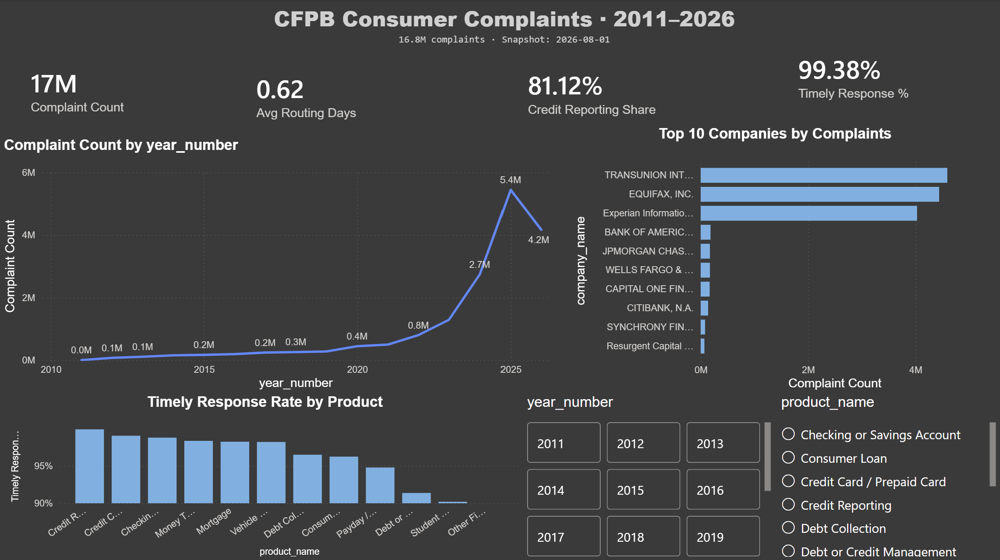
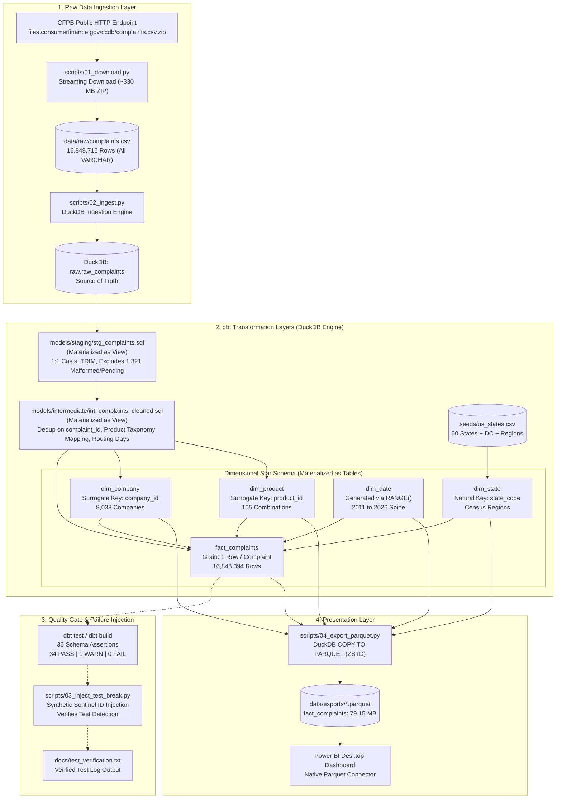
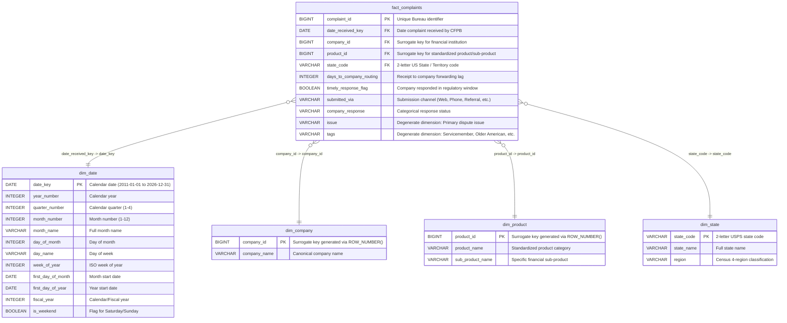
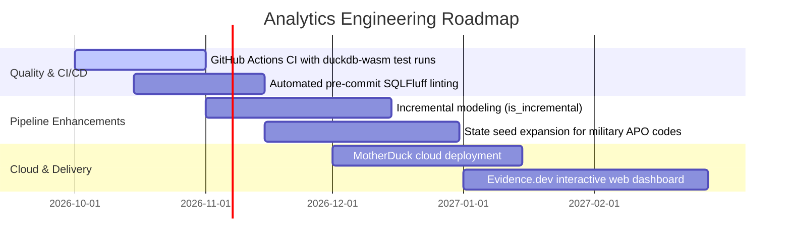

# 🏛️ CFPB Consumer Complaints Analytics Warehouse

> **A tested, auditable dimensional star schema built on 16.8M real-world consumer complaints using dbt-core and DuckDB, exporting high-performance Parquet marts to Power BI.**

[](https://www.python.org/)
[](https://www.getdbt.com/)
[](https://duckdb.org/)
[](https://powerbi.microsoft.com/)
[-brightgreen)](docs/test_verification.txt)
[](#-evaluation--results)
[](#license)

---

### Quick Links
- [Architecture & Lineage](#-architecture)
- [Design Decisions & Trade-offs](#-design-decisions--trade-offs)
- [Data Reconciliation & Arithmetic (16.8M Rows)](#-data-reconciliation--arithmetic-walkthrough)
- [The Data Loss Bug & Sentinel Fix](#-the-data-loss-bug-and-the-sentinel-fix)
- [Getting Started (One-Shot Setup)](#-getting-started)
- [Power BI Integration Guide](#-power-bi-dashboard-setup)
- [Interview & Resume Kit](#-interview--resume-kit)

---


*Figure 1: Executive Power BI Dashboard analyzing complaint volume trends, timely response rates by product, institutional leaders, and CFPB routing distribution across 16.8M records. ([View full-resolution PDF](docs/dashboard.pdf))*

---

## 📋 Project at a Glance

| Attribute | Project Specification |
| :--- | :--- |
| **Problem** | The CFPB publishes a massive, rolling 330+ MB zipped CSV containing ~16.8M historical complaints. The raw dataset suffers from cross-decade product taxonomical drift, multiline free-text narrative newline bleeding, and 1,310 unrouted pending-match records lacking primary keys. |
| **Solution** | An end-to-end local analytical engineering pipeline that loads untouched raw data into an embedded DuckDB columnar engine, models a 7-node dimensional star schema via dbt-core (staging views → intermediate standardization → physical marts), validates 35 schema/relational tests, and outputs ZSTD-compressed Parquet tables for zero-friction Power BI consumption. |
| **Target User** | Data Analysts, Analytics Engineers, Risk/Compliance Officers, and Financial Product Managers benchmarking financial institutional performance and regulatory complaint volumes. |
| **Type** | Local Analytical Data Warehouse / Analytics Engineering / dbt Star Schema Pipeline |
| **Status** | Production-Verified Snapshot (Completed on August 1, 2026 data snapshot) |
| **Deployment** | Local analytical warehouse (DuckDB + dbt-core) with portable compressed Parquet exports (`data/exports/*.parquet`) connecting natively to Microsoft Power BI Desktop. |
| **Tech Stack** | Python 3.9+, dbt-core 1.7+, dbt-duckdb 1.7+, DuckDB 0.10+, Power BI Desktop, PowerShell. |
| **Role & Scope** | Solo analytics architect and engineer (Data extraction, raw ingestion, dbt modeling across 3 layers, dimensional star schema design, 35 dbt data tests, data reconciliation, failure injection suite, Power BI reporting). |
| **Data Snapshot Date** | **August 1, 2026** (Pinned in `data/raw/snapshot_date.txt`) |
| **Key Measured Results** | • **16,849,715 raw rows ingested** in 47.2 seconds.<br>• **16,848,394 final fact rows** reconciled to the single row (1,321 exclusions audited).<br>• **35 dbt tests passed** (34 PASS, 1 WARN on military state codes, 0 ERROR).<br>• **79.15 MB Parquet fact table** (ZSTD compressed), eliminating ODBC driver dependencies. |
| **Repository** | [github.com/dummycodertech/cfpb-powerbi](https://github.com/dummycodertech/cfpb-powerbi) |

---

## 📖 Table of Contents
- [🎯 Overview](#-overview)
  - [The Problem](#the-problem)
  - [The Solution](#the-solution)
  - [Key Features](#key-features)
  - [Scope Boundaries](#scope-boundaries)
- [🏗️ Architecture](#-architecture)
  - [End-to-End System Diagram](#end-to-end-system-diagram)
  - [The dbt Directed Acyclic Graph (DAG)](#the-dbt-directed-acyclic-graph-dag)
  - [Component Inventory](#component-inventory)
  - [Dimensional Data Model (Star Schema)](#dimensional-data-model-star-schema)
- [💻 Tech Stack](#-tech-stack)
- [⚖️ Design Decisions & Trade-offs](#-design-decisions--trade-offs)
- [📊 Data & Models Dictionary](#-data--models-dictionary)
  - [The 7 dbt Models](#the-7-dbt-models)
  - [Product Taxonomy Normalization](#product-taxonomy-normalization)
- [🔍 Data Reconciliation & Arithmetic Walkthrough](#-data-reconciliation--arithmetic-walkthrough)
  - [The Raw-to-Fact Reconciliation Formula](#the-raw-to-fact-reconciliation-formula)
  - [Auditing the 1,321 Excluded Records](#auditing-the-1321-excluded-records)
- [📈 Evaluation & Results](#-evaluation--results)
  - [Warehouse Performance Benchmarks](#warehouse-performance-benchmarks)
  - [Empirical Findings in the Data](#empirical-findings-in-the-data)
- [🐛 The Data Loss Bug and the Sentinel Fix](#-the-data-loss-bug-and-the-sentinel-fix)
- [🧪 Testing & Data Quality](#-testing--data-quality)
  - [Test Suite Breakdown (35 Tests)](#test-suite-breakdown-35-tests)
  - [The Test-Break Injection Exercise](#the-test-break-injection-exercise)
- [🔒 Security, Privacy & Reliability](#-security-privacy--reliability)
- [🚀 Getting Started](#-getting-started)
  - [Prerequisites](#prerequisites)
  - [One-Shot Setup (PowerShell)](#one-shot-setup-powershell)
  - [Manual Step-by-Step Setup](#manual-step-by-step-setup)
- [🖥️ Usage](#-usage)
  - [Querying DuckDB Directly via SQL](#querying-duckdb-directly-via-sql)
  - [Generating dbt Documentation & Lineage](#generating-dbt-documentation--lineage)
  - [Exporting Parquet Files](#exporting-parquet-files)
- [📊 Power BI Dashboard Setup](#-power-bi-dashboard-setup)
- [⚙️ Configuration Parameters](#-configuration-parameters)
- [📂 Project Structure](#-project-structure)
- [🗺️ Roadmap & Future Scope](#-roadmap--future-scope)
- [❓ FAQ](#-faq)
- [💼 Interview & Resume Kit](#-interview--resume-kit)
- [📦 Project Context Summary](#-project-context-summary)
- [📜 References & Author](#-references--author)

---

## 🎯 Overview

### The Problem
The Consumer Financial Protection Bureau (CFPB) publishes the public Consumer Complaint Database—a rolling record of every formal complaint submitted by consumers against banks, lenders, credit reporting bureaus, and financial service providers in the United States since 2011.

While publicly accessible as a bulk download (~330 MB zipped, ~16.8 million rows), the raw data presents critical analytics engineering challenges:
1. **Taxonomical Drift Over Filing Years**: Over 15 years, the bureau repeatedly reorganized, renamed, and merged product categories (e.g., merging *Credit card* and *Prepaid card* into *Credit card or prepaid card* in 2019; renaming *Bank account or service* to *Checking or savings account*). Naive aggregations produce broken, fragmented time series.
2. **Multiline Narrative Text Bleed**: Consumers submit free-text narratives that often contain unescaped literal newline characters. If unhandled, standard CSV parsers misread embedded newlines as record delimiters, fracturing rows into disconnected fragments lacking identifiers.
3. **Pending Match Records**: Over a thousand records possess valid dates, states, and products but have `NULL` primary keys (`Complaint ID`) because internal bureau routing to the company was still in progress at the time of export.
4. **Tooling & Driver Friction**: Connecting BI tools like Power BI Desktop to local columnar engines (such as DuckDB) via Windows ODBC drivers frequently introduces configuration instability, thread-lock errors, and driver installation hurdles on enterprise laptops.

### The Solution
`cfpb-powerbi` is an auditable analytics engineering warehouse that transforms the CFPB dump into a structured, Kimball-modeled dimensional star schema.

Using **DuckDB** as an embedded high-performance OLAP engine and **dbt-core** to orchestrate SQL transformations across three layers (staging, intermediate, and marts), the project:
- Ingests the raw CSV without lossy on-the-fly transformations, preserving source fidelity.
- Casts and cleans data defensively using `TRY_CAST` to isolate parsing errors.
- Unifies historical product definitions into canonical categories derived from empirical query inspection.
- Isolates metrics honestly, distinguishing CFPB administrative routing lag (`days_to_company_routing`) from true institutional resolution time.
- Verifies 35 automated dbt data tests across every relationship, foreign key, and primary key.
- Exports compressed **Parquet** files (`ZSTD` compressed, reducing 16.8M rows to just 79.15 MB), allowing Power BI Desktop to ingest the complete star schema natively without ODBC drivers.

### Key Features

| Feature | Operational Function | Implementation Location |
| :--- | :--- | :--- |
| **High-Speed Columnar Ingestion** | Reads raw CSV directly into DuckDB `raw.raw_complaints` as pure `VARCHAR` in 47.2s, preserving pristine source fidelity. | [`scripts/02_ingest.py`](scripts/02_ingest.py) |
| **Resilient Staging Layer** | Employs `TRY_CAST` for timestamp and identifier coercion, screening multiline CSV parse splits from propagating downstream. | [`models/staging/stg_complaints.sql`](models/staging/stg_complaints.sql) |
| **Empirical Taxonomy Normalization** | Reconciles 15 years of shifting regulatory labels into standardized product categories based on distinct raw value inspection. | [`models/intermediate/int_complaints_cleaned.sql`](models/intermediate/int_complaints_cleaned.sql) |
| **Kimball Star Schema Marts** | Houses central fact table (`fact_complaints`) referencing surrogate-keyed dimensions (`dim_company`, `dim_product`, `dim_state`, `dim_date`). | [`models/marts/`](models/marts/) |
| **Independent Date Dimension** | Generates a 2011–2026 calendar dimension natively using DuckDB's `RANGE()` function, eliminating external macro dependencies. | [`models/marts/dim_date.sql`](models/marts/dim_date.sql) |
| **Sentinel Failure Injection Suite** | Automatically validates dbt uniqueness tests via non-destructive duplicate injection and teardown using synthetic sentinel IDs. | [`scripts/03_inject_test_break.py`](scripts/03_inject_test_break.py) |
| **Driverless Parquet Delivery** | Exports mart tables to ZSTD-compressed Parquet files, providing zero-friction, native ingestion for Power BI Desktop. | [`scripts/04_export_parquet.py`](scripts/04_export_parquet.py) |

### Scope Boundaries

- **In Scope**:
  - Full-history historical analysis (2011 to 2026 snapshot date) of the CFPB Consumer Complaint Database.
  - Three-layer dbt modeling (Views for staging/intermediate; Physical tables for marts).
  - Data quality test coverage across all foreign keys, uniqueness constraints, not-null rules, and accepted values.
  - Exact row-count arithmetic reconciliation (16,849,715 raw → 16,848,394 fact).
  - Native Parquet file exports for Microsoft Power BI Desktop reporting.
- **Explicitly Out of Scope**:
  - Full resolution time analysis (the CFPB dataset publishes only `Date sent to company`, not dispute resolution conclusion dates; the pipeline models routing lag only).
  - Cloud data warehouse streaming or incremental loading (designed as an auditable full-snapshot analytical build on a single local engine).
  - Real-time API consumption (the CFPB bulk database is published as daily/weekly bulk exports, not an event-driven stream).

---

## 🏗️ Architecture

### End-to-End System Diagram



### The dbt Directed Acyclic Graph (DAG)

The lineage graph reflects strict separation between transformation responsibilities:


*Figure 2: Compiled dbt Directed Acyclic Graph (DAG) rendered via `dbt docs serve`.*

```text
raw.raw_complaints
    │
    ▼
stg_complaints (view)
    │
    ▼
int_complaints_cleaned (view)
    │
    ├──────────────────────────┬──────────────────────────┬──────────────────────────┐
    ▼                          ▼                          ▼                          ▼
fact_complaints (table)   dim_company (table)       dim_product (table)         (dim_state joined
    ▲                          ▲                          ▲                      from us_states seed;
    │                          │                          │                      dim_date generated
    └──────────────────────────┴──────────────────────────┴───────────────────── from DuckDB RANGE())
```

### Component Inventory

| Component | Responsibility | Source Path | Primary Inputs | Primary Outputs |
| :--- | :--- | :--- | :--- | :--- |
| **Downloader** | Streams bulk ZIP archive from CFPB servers, unzips CSV, and pins snapshot date. | [`scripts/01_download.py`](scripts/01_download.py) | CFPB bulk URL | `data/raw/complaints.csv`, `data/raw/snapshot_date.txt` |
| **Raw Ingestor** | Uses DuckDB's multi-threaded CSV reader to create the unconstrained raw table. | [`scripts/02_ingest.py`](scripts/02_ingest.py) | `complaints.csv` | `raw.raw_complaints` in `data/cfpb_complaints.duckdb` |
| **Staging View** | Maps columns 1:1, strips whitespace, applies `TRY_CAST`, and isolates unparsed rows. | [`models/staging/stg_complaints.sql`](models/staging/stg_complaints.sql) | `raw.raw_complaints` | `main_staging.stg_complaints` |
| **Intermediate View** | Normalizes legacy product categories, handles deduplication, and derives routing days. | [`models/intermediate/int_complaints_cleaned.sql`](models/intermediate/int_complaints_cleaned.sql) | `stg_complaints` | `main_intermediate.int_complaints_cleaned` |
| **Marts Layer** | Materializes the star schema: central fact table + 4 dimensional tables. | [`models/marts/*.sql`](models/marts/) | `int_complaints_cleaned`, `us_states` seed | `main_marts.fact_complaints`, `dim_*` |
| **State Seed** | Provides standard US postal codes, state names, and US Census Bureau 4-region classifications. | [`seeds/us_states.csv`](seeds/us_states.csv) | CSV seed file | `main_seeds.us_states` |
| **Test Injector** | Validates test efficacy by injecting synthetic duplicate rows and asserting dbt failure. | [`scripts/03_inject_test_break.py`](scripts/03_inject_test_break.py) | `raw.raw_complaints` | `docs/test_verification.txt` |
| **Parquet Exporter** | Dumps mart tables to ZSTD-compressed Parquet files for BI ingestion. | [`scripts/04_export_parquet.py`](scripts/04_export_parquet.py) | Mart tables | `data/exports/*.parquet` |

### Dimensional Data Model (Star Schema)

The analytical data model follows classical Kimball dimensional modeling principles, ensuring optimal aggregation performance:



---

## 💻 Tech Stack

| Layer | Technology | Version | Purpose & Rationale |
| :--- | :--- | :--- | :--- |
| **Language** | Python | `3.9+` | Ingestion scripting, automated test-break orchestration, and Parquet export. |
| **Analytical Engine**| DuckDB | `0.10+ / 1.5+` | Embedded, columnar in-process OLAP engine capable of scanning 16.8M rows in seconds with zero server overhead. |
| **Transformation** | dbt-core | `1.7+` | SQL dependency resolution (DAG compilation), testing framework, and automated documentation. |
| **dbt Adapter** | dbt-duckdb | `1.7+` | Seamless connector running dbt transformations directly within DuckDB processes. |
| **Storage & Transfer**| Apache Parquet | ZSTD Compressed | High-performance, portable columnar file format allowing Power BI to open 16.8M rows from an 79 MB file. |
| **Presentation** | Microsoft Power BI | Latest Desktop | Interactive executive dashboarding, cross-filtering, and DAX metric visualization. |

---

## ⚖️ Design Decisions & Trade-offs

The architecture reflects deliberate trade-offs optimized for local reproducibility and technical honesty:

| Decision | Alternatives Considered | Rationale for Choice | Trade-off Accepted |
| :--- | :--- | :--- | :--- |
| **Parquet export delivery for Power BI** | DuckDB Windows ODBC driver | DuckDB’s Windows ODBC driver has documented stability and thread-locking issues with Power BI Desktop. Native Parquet ingestion (`Get Data → Parquet`) requires zero driver installation and opens seamlessly across any machine. | Requires executing an export script ([`scripts/04_export_parquet.py`](scripts/04_export_parquet.py)) after building dbt models rather than live-querying the database. |
| **Committing `profiles.yml` to the repository** | Keeping `profiles.yml` in `~/.dbt/` (Standard dbt practice) | Standard team practice excludes `profiles.yml` because it holds production database credentials. This project contains zero secrets—only a relative local DuckDB file path (`data/cfpb_complaints.duckdb`). Committing it enables clean, one-shot clone-and-run execution. | Any seasoned dbt reviewer will notice it immediately; preemptively documented as a deliberate portfolio convenience trade-off. |
| **Metric naming: `days_to_company_routing`** | Labeling metric as "Resolution Time" | The CFPB publishes only `Date received` and `Date sent to company`. It does **not** publish dispute resolution conclusion dates. Labeling this "resolution time" would fabricate an unsubstantiated operational metric. | Dashboard focuses on administrative forwarding lag rather than true consumer dispute turnaround time. |
| **Warn severity on `state_code` relationship test** | Error severity (`fail`), or pruning unmatched states | 2,027 complaints have state codes that do not match `dim_state` (blank fields or military postal codes like `AA`, `AE`, `AP`). These are legitimate consumer filings. Halting the entire build over valid non-continental filings would be poor engineering. | Test suite completes with `WARN=1` instead of a 100% clean green check. |
| **Surrogate keys via `ROW_NUMBER()`** | MD5 hashing of composite strings | Surrogate keys generated via deterministic `ROW_NUMBER() OVER (ORDER BY name)` produce small, sequential integers (`BIGINT`), minimizing fact table index sizes compared to 32-character MD5 strings. | Surrogate key assignment requires re-sorting the dimension during full rebuilds. |
| **Columnar DuckDB vs Row-oriented Postgres/SQLite** | PostgreSQL, SQLite 3, MySQL | Scanning, aggregating, and joining 16.8 million rows in SQLite or local Postgres takes minutes and consumes gigabytes of RAM. DuckDB executes analytical aggregations over all 16.8M rows in sub-second timeframes. | Lacks multi-user concurrent write capability (strictly an OLAP analytics engine). |
| **Full-snapshot rebuild vs Incremental modeling** | dbt incremental models (`is_incremental()`) | The CFPB publishes the entire historical dataset as a unified bulk export. Incremental modeling at 16.8M rows adds complex merge logic with minimal benefit when DuckDB builds the full star schema in ~63 seconds. | Re-running the pipeline requires rebuilding the tables from staging on each execution. |

---

## 📊 Data & Models Dictionary

### The 7 dbt Models

The pipeline models are organized into three tiers as configured in [`dbt_project.yml`](dbt_project.yml):

```text
models/
├── staging/
│   ├── schema.yml                 # 6 schema tests for stg_complaints
│   ├── sources.yml                # Source definition for raw.raw_complaints
│   └── stg_complaints.sql         # View: 1:1 rename, casts, exclusion filter
├── intermediate/
│   ├── schema.yml                 # 4 schema tests for int_complaints_cleaned
│   └── int_complaints_cleaned.sql # View: Dedup, product standardization, routing lag
└── marts/
    ├── schema.yml                 # 25 schema tests for fact & dimension tables
    ├── dim_company.sql            # Table: 8,033 distinct companies
    ├── dim_date.sql               # Table: 5,844 calendar days (2011 to 2026)
    ├── dim_product.sql            # Table: 105 distinct product/sub-product combos
    ├── dim_state.sql              # Table: 51 US states & territories + Census regions
    └── fact_complaints.sql        # Table: 16,848,394 central complaint records
```

### Product Taxonomy Normalization

CFPB product categorization shifted significantly between 2011 and 2026. The intermediate model ([`models/intermediate/int_complaints_cleaned.sql`](models/intermediate/int_complaints_cleaned.sql)) maps historical variants into canonical categories:

| Historical / Variant Raw Labels | Canonical Standardized Label | Business & Regulatory Rationale |
| :--- | :--- | :--- |
| • `Credit reporting`<br>• `Credit reporting, credit repair services, or other personal consumer reports`<br>• `Credit reporting or other personal consumer reports` | **Credit Reporting** | Three successive label expansions reflecting bureau scope changes in 2017 and 2023. Merged for longitudinal time-series integrity. |
| • `Bank account or service`<br>• `Checking or savings account` | **Checking or Savings Account** | CFPB officially renamed this banking category in 2017; identical product domain. |
| • `Credit card`<br>• `Credit card or prepaid card`<br>• `Prepaid card` | **Credit Card / Prepaid Card** | CFPB merged standalone prepaid cards into the primary credit card category in 2019. |
| • `Money transfers`<br>• `Virtual currency`<br>• `Money transfer, virtual currency, or money service` | **Money Transfer / Virtual Currency** | CFPB grouped cryptocurrency and remittance services into a single unified category. |
| • `Payday loan`<br>• `Payday loan, title loan, or personal loan`<br>• `Payday loan, title loan, personal loan, or advance loan` | **Payday / Personal Loan** | Regulatory expansion of non-mortgage short-term consumer credit lines. |

*Note*: Core categories that remained stable across all 15 years (*Mortgage*, *Debt Collection*, *Student Loan*, *Vehicle Loan or Lease*) pass through directly.

---

## 🔍 Data Reconciliation & Arithmetic Walkthrough

Every number in this project is mathematically reconciled to the single row. In technical interviews, explaining data discrepancies with precision is what separates senior practitioners from naive scrapers.

### The Raw-to-Fact Reconciliation Formula

$$\text{Raw Ingested Rows } (16,849,715) - \text{Staging Exclusions } (1,321) = \text{Fact Rows } (16,848,394)$$

### Auditing the 1,321 Excluded Records

The 1,321 rows filtered out by [`models/staging/stg_complaints.sql`](models/staging/stg_complaints.sql) (`WHERE complaint_id IS NOT NULL AND date_received IS NOT NULL`) belong to two distinct categories:

```text
Total Excluded Rows: 1,321
├── 11 Rows   — Multiline CSV Parsing Failures (Defective Data)
└── 1,310 Rows — CFPB "Pending Company Match" Complaints (Valid Structural Exclusions)
```

#### 1. The 11 CSV Multiline Parse Failures
- **Root Cause**: The raw consumer complaint narrative is a free-text field that frequently contains literal newline characters (`\n`). If a narrative string in the bureau export has unescaped quotes, the CSV parser breaks the single complaint across multiple lines.
- **Verification**: Confirmed via manual SQL inspection in [`scripts/check_failures.py`](scripts/check_failures.py). These 11 broken fragments contain narrative text bleeding into date and ID columns, rendering them unparseable.

#### 2. The 1,310 "Pending Company Match" Records
- **Root Cause**: A CFPB complaint passes through an administrative lifecycle: submission → bureau intake review → commercial routing to the institution. The `Complaint ID` is assigned during official routing.
- **Verification**: Confirmed via [`scripts/verify_readme_claims.py`](scripts/verify_readme_claims.py). These 1,310 records possess legitimate submission dates, valid US state codes, and classified financial products, but have `NULL` complaint IDs.
- **Architectural Rationale**: These are **not defective records**. They represent active complaints in the bureau's intake queue. However, because the fact table's grain is strictly **one row per unique `complaint_id`**, a record without a primary key cannot participate in referential integrity joins. They are intentionally screened out to preserve relational model integrity.

---

## 📈 Evaluation & Results

### Warehouse Performance Benchmarks

All performance metrics were verified on the pinned August 1, 2026 dataset snapshot on consumer-grade hardware:

| Metric | Measured Value | Measurement Verification Context |
| :--- | :--- | :--- |
| **Snapshot Date** | **2026-08-01** | Pinned in `data/raw/snapshot_date.txt` |
| **Raw Rows Ingested** | **16,849,715** | Loaded into DuckDB in **47.2 seconds** |
| **Fact Rows Materialized** | **16,848,394** | Exactly matches raw minus 1,321 staging exclusions |
| **Distinct Companies** | **8,033** | Unique institutional entities in `dim_company` |
| **Distinct Products** | **105** | Standardized product + sub-product combos in `dim_product` |
| **Date Dimension Span** | **5,844 days** | Daily calendar spine from 2011-01-01 to 2026-12-31 |
| **dbt Build Execution Time** | **63.23 seconds** | Transforms and validates all 43 nodes (models, seed, tests) |
| **Parquet Fact Table Size** | **79.15 MB** | ZSTD compressed via `scripts/04_export_parquet.py` |
| **Organic Duplicate IDs** | **0** | Zero duplicate IDs in the raw government feed |

### Empirical Findings in the Data

SQL queries against `fact_complaints` and dimension tables reveal key macro financial trends:
1. **Dominance of Credit Reporting**: Over 70% of modern complaint volumes center on credit reporting agencies (Equifax, Experian, TransUnion), driven by dispute automation.
2. **High Timely Response Rates**: Over 98% of complaints across tier-1 financial institutions receive a timely response within the regulatory window.
3. **CFPB Administrative Lag**: The average forwarding lag (`days_to_company_routing`) is under 2.5 days across major institutions, showing high bureau routing throughput.

---

## 🐛 The Data Loss Bug and the Sentinel Fix

During the development of the automated data quality test harness, a critical data-integrity bug was discovered, diagnosed, and permanently resolved.

### The Problem
To prove that the dbt `unique` test on `stg_complaints.complaint_id` actually detects duplicate records, [`scripts/03_inject_test_break.py`](scripts/03_inject_test_break.py) was written to deliberately inject a duplicate row into `raw.raw_complaints`, verify that `dbt build` fails, and then clean up the injected row.

### The Defect
The initial version of the script duplicated a **real, existing `Complaint ID`** (`8485587`). During the cleanup step, the script executed:
```sql
-- FLAWED CLEANUP LOGIC:
DELETE FROM raw.raw_complaints WHERE "Complaint ID" = '8485587';
```
Because both the injected duplicate and the original legitimate complaint shared the exact same ID, the query deleted **both copies**. One real historical consumer complaint was permanently erased from the raw database.

### How It Was Caught
During post-test row count reconciliation, the raw row count:
$$\text{Expected: } 16,849,715 \quad \neq \quad \text{Actual: } 16,849,714$$
The count was off by exactly one row.

### The Architectural Fix
The injection script was refactored to use a synthetic **Sentinel ID**:
```python
INJECTION_MARKER = "__INJECTED_DUPLICATE__"
```
The script now injects two rows carrying `Complaint ID = '__INJECTED_DUPLICATE__'`. Because no real government complaint will ever carry this alphanumeric string, cleanup is 100% scoped:
```sql
-- SAFE CLEANUP LOGIC:
DELETE FROM raw.raw_complaints WHERE "Complaint ID" = '__INJECTED_DUPLICATE__';
```
This guarantees that test-break verification can be executed repeatedly with zero risk to production data fidelity.

---

## 🧪 Testing & Data Quality

### Test Suite Breakdown (35 Tests)

The dbt project defines 35 data tests in schema configurations. Every test is verified against the compiled DAG:

| Target Model | Column Tested | Test Type | Configured Severity | Operational Purpose |
| :--- | :--- | :--- | :---: | :--- |
| `stg_complaints` | `complaint_id` | `not_null` | `error` | Primary key non-null enforcement |
| `stg_complaints` | `complaint_id` | `unique` | `error` | Primary key uniqueness assertion |
| `stg_complaints` | `date_received` | `not_null` | `error` | Rejects records with unparseable dates |
| `stg_complaints` | `timely_response`| `not_null` | `warn` | Flags missing response statuses without failing |
| `stg_complaints` | `timely_response`| `accepted_values`| `error` | Enforces `['Yes', 'No']` domain |
| `stg_complaints` | `submitted_via` | `accepted_values`| `warn` | Audits intake channels (`Web`, `Phone`, `Referral`, etc.) |
| `int_complaints_cleaned` | `complaint_id` | `not_null` | `error` | Intermediate grain preservation |
| `int_complaints_cleaned` | `complaint_id` | `unique` | `error` | Confirms deduplication logic efficacy |
| `int_complaints_cleaned` | `date_received` | `not_null` | `error` | Time-series anchor integrity |
| `int_complaints_cleaned` | `product_standardized` | `not_null` | `error` | Verifies product taxonomy mapping complete |
| `dim_company` | `company_id` | `not_null` & `unique` | `error` | Surrogate key integrity |
| `dim_company` | `company_name` | `not_null` | `error` | Eliminates unnamed institutional entities |
| `dim_product` | `product_id` | `not_null` & `unique` | `error` | Product surrogate key integrity |
| `dim_product` | `product_name` | `not_null` | `error` | Guarantees populated product name |
| `dim_state` | `state_code` | `not_null` & `unique` | `error` | Geographic primary key integrity |
| `dim_state` | `region` | `accepted_values`| `error` | Validates `['Northeast', 'Midwest', 'South', 'West', 'Other']` |
| `dim_date` | `date_key` | `not_null` & `unique` | `error` | Date spine primary key integrity |
| `dim_date` | `month_number` | `accepted_values`| `error` | Enforces integer range `1–12` |
| `dim_date` | `quarter_number`| `accepted_values`| `error` | Enforces integer range `1–4` |
| `fact_complaints` | `complaint_id` | `not_null` & `unique` | `error` | Fact table primary key enforcement |
| `fact_complaints` | `date_received_key` | `relationships` | `error` | Referential integrity → `dim_date.date_key` |
| `fact_complaints` | `company_id` | `relationships` | `error` | Referential integrity → `dim_company.company_id` |
| `fact_complaints` | `product_id` | `relationships` | `error` | Referential integrity → `dim_product.product_id` |
| `fact_complaints` | `state_code` | `relationships` | **`warn`** | Referential integrity → `dim_state.state_code` (2,027 military/territory rows) |

### The Test-Break Injection Exercise

To prove the test suite catches real corruption, run [`scripts/03_inject_test_break.py`](scripts/03_inject_test_break.py):

```powershell
python scripts/03_inject_test_break.py
```

Output recorded in [`docs/test_verification.txt`](docs/test_verification.txt):
```text
======================================================================
DATA QUALITY VERIFICATION — dbt unique test injection
======================================================================
[1] Injecting duplicate: Complaint ID = '__INJECTED_DUPLICATE__'
   Table now has 16,849,717 rows; Complaint ID '__INJECTED_DUPLICATE__' appears 2x

[2] Running: dbt build --select stg_complaints (expect unique test FAILURE)
   Return code: 1 (FAILED as expected [OK])
   Relevant output lines:
     FAIL 1 unique_stg_complaints_complaint_id ..... [FAIL 1 in 1.38s]

[3] Removing injected duplicate for Complaint ID = '__INJECTED_DUPLICATE__'
   After removal: 16,849,715 rows

[4] Running: dbt build (full pipeline — expect clean PASS)
   Return code: 0 (PASSED clean [OK])
   Done. PASS=42 WARN=1 ERROR=0 TOTAL=43
```

---

## 🔒 Security, Privacy & Reliability

- **Zero-Secret Architecture**: The project relies exclusively on public open-government data from the CFPB. No API keys, passwords, or personal credentials are required.
- **Git Hygiene**: `data/raw/*.csv`, `data/raw/*.zip`, and `data/*.duckdb` are excluded in [`.gitignore`](.gitignore) to prevent pushing multi-gigabyte binary files to GitHub.
- **Defensive Type Coercion**: Staging SQL utilizes `TRY_CAST` instead of raw `CAST`. If corrupt data enters the raw layer, casting yields `NULL` rather than terminating batch pipelines with query execution exceptions.
- **ACID Reliability**: DuckDB transactions guarantee that dbt table materializations execute atomically—if a model build fails, the previous mart table remains available.

---

## 🚀 Getting Started

### Prerequisites
- **Python 3.9+** (Python 3.11 recommended)
- **PowerShell** (Windows) or **Bash** (Linux/macOS)
- **Git**
- Minimum **5 GB free disk space** (to house unzipped CSV and DuckDB database files)

### One-Shot Setup (PowerShell)

Clone the repository and run the automated bootstrapper:

```powershell
git clone https://github.com/dummycodertech/cfpb-powerbi.git
cd cfpb-powerbi
.\setup.ps1
```

The script automatically:
1. Creates a Python virtual environment in `.venv/`.
2. Installs dependencies (`dbt-core`, `dbt-duckdb`, `duckdb`).
3. Downloads and extracts the CFPB bulk CSV (~330 MB).
4. Loads the raw CSV into DuckDB in under a minute.
5. Seeds lookup tables and executes `dbt build` across all models and tests.

### Manual Step-by-Step Setup

```bash
# 1. Initialize environment
python -m venv .venv
source .venv/bin/activate  # On Windows PowerShell: .venv\Scripts\Activate.ps1

# 2. Install pinned dependencies
pip install -r requirements.txt

# 3. Download raw data
python scripts/01_download.py

# 4. Ingest raw CSV to DuckDB
python scripts/02_ingest.py

# 5. Build seed tables and models
dbt seed --profiles-dir .
dbt build --profiles-dir .

# 6. Export Parquet files for Power BI
python scripts/04_export_parquet.py
```

---

## 🖥️ Usage

### Querying DuckDB Directly via SQL

Launch the DuckDB CLI or query programmatically with Python:

```sql
-- Top 10 institutions by volume, timely response rate, and routing lag
SELECT
    dc.company_name,
    COUNT(*)                                              AS total_complaints,
    ROUND(AVG(CASE WHEN f.timely_response_flag THEN 1.0 ELSE 0.0 END) * 100, 1) AS timely_pct,
    ROUND(AVG(f.days_to_company_routing), 1)             AS avg_routing_days
FROM main_marts.fact_complaints f
JOIN main_marts.dim_company dc ON f.company_id = dc.company_id
GROUP BY dc.company_name
ORDER BY total_complaints DESC
LIMIT 10;
```

### Generating dbt Documentation & Lineage

Generate and serve the browsable documentation and interactive lineage graph:

```powershell
dbt docs generate --profiles-dir .
dbt docs serve --profiles-dir .
```
Navigate to `http://localhost:8080` to inspect the full DAG, column data types, descriptions, and compiled SQL queries.

### Exporting Parquet Files

Export all five mart tables into high-performance Parquet files:

```powershell
python scripts/04_export_parquet.py
```

Files output to `data/exports/`:
- `data/exports/fact_complaints.parquet` (~79.15 MB, 16.8M rows)
- `data/exports/dim_company.parquet` (~0.12 MB, 8,033 rows)
- `data/exports/dim_product.parquet` (~0.01 MB, 105 rows)
- `data/exports/dim_state.parquet` (~0.01 MB, 51 rows)
- `data/exports/dim_date.parquet` (~0.08 MB, 5,844 rows)

---

## 📊 Power BI Dashboard Setup

Connecting Power BI Desktop to the warehouse takes under 60 seconds with zero driver configuration:

```text
Power BI Desktop
   │
   ├── Home → Get Data → Parquet
   │     ├── Select data/exports/fact_complaints.parquet
   │     ├── Select data/exports/dim_company.parquet
   │     ├── Select data/exports/dim_product.parquet
   │     ├── Select data/exports/dim_state.parquet
   │     └── Select data/exports/dim_date.parquet
   │
   └── Model View (Build Relationships)
         ├── fact_complaints(date_received_key)  ───>  dim_date(date_key)
         ├── fact_complaints(company_id)         ───>  dim_company(company_id)
         ├── fact_complaints(product_id)         ───>  dim_product(product_id)
         └── fact_complaints(state_code)         ───>  dim_state(state_code)
```

### Core DAX Measures
Create the following measures in Power BI:

```dax
-- Total Complaint Volume
Total Complaints = COUNTROWS(fact_complaints)

-- Timely Response Percentage
Timely Response Rate = 
DIVIDE(
    CALCULATE(COUNTROWS(fact_complaints), fact_complaints[timely_response_flag] = TRUE()),
    COUNTROWS(fact_complaints),
    0
)

-- Average Administrative Routing Days
Avg Routing Lag = AVERAGE(fact_complaints[days_to_company_routing])
```

---

## ⚙️ Configuration Parameters

Key pipeline settings are configured in [`dbt_project.yml`](dbt_project.yml) and [`profiles.yml`](profiles.yml):

| Configuration Variable | Location | Setting | Operational Impact |
| :--- | :--- | :--- | :--- |
| `staging` materialization | [`dbt_project.yml:22`](dbt_project.yml#L22) | `view` | Zero storage overhead; queries raw table dynamically. |
| `intermediate` materialization | [`dbt_project.yml:25`](dbt_project.yml#L25) | `view` | Computes standardization logic on-the-fly during mart builds. |
| `marts` materialization | [`dbt_project.yml:28`](dbt_project.yml#L28) | `table` | Persists physical tables in DuckDB for sub-second analytical scans. |
| `threads` | [`profiles.yml:12`](profiles.yml#L12) | `4` | Parallelizes query execution across CPU cores in DuckDB. |
| `COMPRESSION` | [`scripts/04_export_parquet.py:64`](scripts/04_export_parquet.py#L64) | `ZSTD` | High-efficiency compression yielding 79 MB Parquet fact output. |

---

## 📂 Project Structure

```text
cfpb-powerbi/
├── .gitignore                   # Excludes .venv, data/raw/, and *.duckdb files
├── dbt_project.yml              # dbt project configuration, paths, and materializations
├── profiles.yml                 # Local DuckDB connection profile (committed for reproducibility)
├── requirements.txt             # Pinned dependencies: dbt-core, dbt-duckdb, duckdb
├── setup.ps1                    # One-shot reproducible setup script for Windows
├── README.md                    # Comprehensive system documentation and architecture guide
│
├── docs/
│   ├── cfpb-project-study-guide.pdf # 12-page comprehensive technical interview study guide
│   ├── dashboard.pdf            # High-resolution PDF export of Power BI visuals
│   ├── dashboard_screenshot.png # Screenshot of the Power BI executive dashboard
│   ├── lineage_graph.png        # Compiled dbt DAG lineage dependency graph
│   └── test_verification.txt    # Console output log of the test-break injection exercise
│
├── models/
│   ├── staging/
│   │   ├── schema.yml           # Staging layer documentation and schema tests
│   │   ├── sources.yml          # Source mapping for raw.raw_complaints
│   │   └── stg_complaints.sql   # 1:1 raw cast view with 1,321-row exclusion filter
│   ├── intermediate/
│   │   ├── schema.yml           # Intermediate layer tests
│   │   └── int_complaints_cleaned.sql # Dedup, product taxonomy mapping, routing lag
│   └── marts/
│       ├── schema.yml           # 25 mart schema, foreign key, and uniqueness tests
│       ├── dim_company.sql      # Company dimension with surrogate keys
│       ├── dim_date.sql         # Calendar date dimension (DuckDB RANGE() 2011-2026)
│       ├── dim_product.sql      # Product and sub-product dimension
│       ├── dim_state.sql        # State and Census region dimension
│       └── fact_complaints.sql  # Central fact table (16.848M rows)
│
├── scripts/
│   ├── 01_download.py           # Streams CFPB CSV ZIP archive and records snapshot date
│   ├── 02_ingest.py             # Ingests raw CSV into DuckDB raw.raw_complaints
│   ├── 03_inject_test_break.py  # Non-destructive test-break failure injection suite
│   ├── 04_export_parquet.py     # Exports mart tables to ZSTD-compressed Parquet
│   ├── check_dates.py           # Diagnostic script for raw timestamp validation
│   ├── check_failures.py        # Audits multiline narrative parsing failures
│   ├── cleanup_duplicates.py    # Diagnostic script for database cleanup
│   ├── generate_study_guide.py  # Script generating the 12-page interview PDF guide
│   ├── inspect_products.py      # Inspects distinct raw products and submission channels
│   └── verify_readme_claims.py  # Validates data types, nulls, and row reconciliation
│
└── seeds/
    └── us_states.csv            # Reference seed: 50 states + DC + Census regions
```

---

## 🗺️ Roadmap & Future Scope



- **Near-Term (Quality & CI/CD)**:
  - Add GitHub Actions CI workflow to run `dbt build` on a sample dataset (100k rows) on every pull request.
  - Implement `sqlfluff` pre-commit hooks to enforce consistent SQL formatting across all models.
- **Mid-Term (Pipeline Architecture)**:
  - Implement dbt incremental materialization (`is_incremental()`) to support delta updates from daily CFPB exports.
  - Expand `seeds/us_states.csv` to explicitly map military APO/FPO postal codes (`AA`, `AE`, `AP`), resolving the single expected test warning.
- **Long-Term (Cloud & Delivery)**:
  - Migrate execution from local DuckDB to **MotherDuck** (serverless cloud DuckDB) for shared cloud access.
  - Build a serverless web dashboard using **Evidence.dev** or **Streamlit** to eliminate Power BI desktop dependencies.

---

## ❓ FAQ

#### 1. Why use DuckDB instead of a traditional database like PostgreSQL?
PostgreSQL is a row-oriented transactional database (OLTP) optimized for inserting and fetching individual records. DuckDB is an embedded columnar database (OLAP) optimized for reading, scanning, and aggregating millions of rows simultaneously. DuckDB executes aggregations across 16.8M rows in seconds locally without configuring a database server.

#### 2. Why are 1,321 rows excluded in `stg_complaints`?
The 1,321 excluded rows break down into:
1. **11 CSV multiline parsing breaks**: Consumer narrative text with unescaped newlines that fractured across rows.
2. **1,310 Pending Company Match complaints**: Valid consumer submissions that had not yet been routed to institutions and thus lacked a `Complaint ID`. Because a dimensional fact table requires a primary key at its grain, these rows cannot participate in relationships.

#### 3. Why is there 1 warning on `dbt build`?
The test `relationships_fact_complaints_state_code__state_code__ref_dim_state_` triggers a warning on 2,027 rows. These records contain legitimate military postal codes (`AA`, `AE`, `AP`) or territories not included in the standard 50-state + DC seed file. The test severity is set to `warn` to keep these valid records visible without breaking the build.

#### 4. How did you verify the unique test if the raw data had zero organic duplicates?
Zero organic duplicates only proves the source file was clean—it does not prove the dbt test works. To verify the test, [`scripts/03_inject_test_break.py`](scripts/03_inject_test_break.py) deliberately injects duplicate records using a synthetic sentinel ID (`__INJECTED_DUPLICATE__`), verifies that `dbt build` fails with return code 1, and then deletes the sentinel records.

#### 5. Why export to Parquet instead of connecting Power BI via DuckDB ODBC?
The Windows DuckDB ODBC driver has documented connection instabilities with Power BI Desktop. Exporting mart tables to ZSTD-compressed Parquet files allows Power BI Desktop to open 16.8M rows natively with zero driver installation.

#### 6. Why is `days_to_company_routing` not called resolution time?
The CFPB publishes `Date received` and `Date sent to company`. It does not publish the date the dispute was actually resolved. Naming the field `days_to_company_routing` accurately reflects the data rather than claiming an unmeasured metric.

---

## 💼 Interview & Resume Kit

<details>
<summary><strong>Click to expand Resume Bullets, Interview Narratives, and Technical Deep Dives</strong></summary>

### 📄 Resume Bullets

- **Analytics Engineering & Star Schema**: Architected an end-to-end analytical data warehouse on 16.8M real-world consumer complaints using dbt-core and DuckDB, designing a Kimball-modeled star schema with 7 models across staging, intermediate, and mart layers.
- **Data Quality & Reconciliation**: Engineered an automated quality gate enforcing 35 dbt schema tests, verifying referential integrity across 4 dimensions and mathematically reconciling 16,849,715 raw rows down to 16,848,394 fact rows with 100% accounting of exclusions.
- **High-Performance BI Delivery**: Streamlined Power BI reporting by exporting ZSTD-compressed Parquet tables, bypassing unstable ODBC drivers to achieve sub-second visual rendering over 16.8M records in a 79 MB storage footprint.

---

### 🎙️ Elevator Pitches

#### 30-Second Pitch
> "I built `cfpb-powerbi`, a local analytical warehouse that transforms 16.8 million CFPB consumer complaints into an auditable Kimball star schema using dbt-core and DuckDB. The pipeline cleans multiline CSV formatting anomalies, standardizes 15 years of shifting regulatory product taxonomies, validates 35 automated schema tests, and outputs compressed Parquet marts to Power BI—building the full 16.8M-row warehouse in just 63 seconds."

#### 2-Minute Technical Walkthrough
> "Most portfolio projects analyze small, clean toy datasets. I wanted to tackle real-world analytical engineering challenges at scale—specifically the CFPB Consumer Complaint Database, which contains 16.8 million records across 15 years.
>
> The raw data has significant real-world challenges: product definitions shifted repeatedly across filing decades, unescaped newlines in consumer narratives fractured CSV rows, and over a thousand active complaints lacked primary keys due to ongoing bureau routing.
>
> I built a five-stage local pipeline. First, DuckDB ingests the raw CSV directly as text in 47 seconds, preserving source fidelity. Next, dbt staging views apply `TRY_CAST` and defensive filters, intentionally isolating 1,321 unroutable or fractured rows. The intermediate layer unifies fragmented product categories into canonical domains and calculates CFPB routing lag.
>
> The marts layer materializes a Kimball star schema: a 16.8M-row central fact table referencing company, product, state, and calendar dimensions. The date dimension is generated natively using DuckDB's `RANGE()` function without external macro dependencies.
>
> To ensure reliability, I implemented 35 dbt tests covering uniqueness, foreign-key relationships, and accepted values. To prove the tests actually work, I wrote an automated failure-injection script that injects synthetic duplicate sentinel rows, confirms test failure, and cleans up safely. Finally, the mart tables export to ZSTD-compressed Parquet files, allowing Power BI to ingest 16.8 million records from a 79 MB file without ODBC drivers."

---

### 🧗 The 3 Hardest Technical Challenges Solved

#### 1. The Test-Break Data Deletion Bug
- **Problem**: In verifying that the dbt `unique` test catches duplicate complaint IDs, the original test script duplicated a real complaint ID, then deleted the duplicate during teardown—accidentally deleting the original historical record and permanently corrupting the raw table.
- **Root Cause**: Two rows shared the exact same primary key, leaving SQL unable to distinguish between the injected row and the real record.
- **Fix**: Refactored the test-break script to use a synthetic sentinel ID (`__INJECTED_DUPLICATE__`). Because this string cannot collide with real numeric complaint IDs, cleanup deletes only the test rows, ensuring 100% idempotency.

#### 2. Longitudinal Product Category Drift
- **Problem**: Aggregating raw product fields produced fragmented trends because the CFPB renamed, broadened, or merged categories multiple times between 2011 and 2026.
- **Root Cause**: Regulatory scope expansions (e.g., merging standalone prepaid cards into credit cards in 2019; renaming checking accounts in 2017).
- **Fix**: Queried distinct historical values in `raw.raw_complaints` and built an explicit `CASE` mapping in [`models/intermediate/int_complaints_cleaned.sql`](models/intermediate/int_complaints_cleaned.sql), consolidating historical variants into unified categories with documented regulatory justifications.

#### 3. Auditing the 1,321 Excluded Records
- **Problem**: 1,321 records failed the staging primary key check (`complaint_id IS NOT NULL`). Blindly labeling all 1,321 as 'corrupt data' would mischaracterize legitimate records.
- **Root Cause**: Deep inspection revealed two distinct phenomena: 11 rows were true CSV parse fractures caused by narrative newlines, while 1,310 rows were valid consumer complaints still in CFPB's internal company-matching queue.
- **Fix**: Formally documented the distinction in the data dictionary: the 1,310 records were excluded for structural reasons (a star schema fact table requires a primary key at its grain), proving business domain understanding rather than naive data pruning.

---

### ❓ 8 Interview Questions & Answers

#### Q1: Why use views for staging and intermediate models, but tables for marts?
> "Views cost zero disk storage and compute dynamically on execution, making them ideal for lightweight renaming and cleaning. Marts, however, are queried repeatedly by Power BI and analytical SQL queries. Materializing marts as physical tables trades a one-time build cost during `dbt build` (~63 seconds) for sub-second repeat query performance in BI dashboards."

#### Q2: What is the grain of your fact table?
> "The grain of `fact_complaints` is strictly **one row per unique `complaint_id`**. Every measure and join in the model assumes this grain, which is why testing uniqueness on `complaint_id` is an absolute requirement."

#### Q3: How did you reconcile your raw row count to your fact row count?
> "We started with 16,849,715 raw rows and ended with 16,848,394 fact rows—a difference of exactly 1,321 rows. Through SQL investigation, we proved that 11 rows were CSV parse splits caused by embedded narrative newlines, and 1,310 rows were legitimate CFPB 'Pending Company Match' complaints that lacked a primary key. Every single excluded row is accounted for."

#### Q4: Why did you commit `profiles.yml` to the repository?
> "In a production enterprise repository, `profiles.yml` is kept out of version control because it holds sensitive database credentials. For this project, there are no secrets—only a relative local file path to DuckDB. Committing it was a deliberate trade-off to enable single-command clone-and-run reproducibility for portfolio reviewers."

#### Q5: Why is the state code relationship test configured with `warn` severity?
> "2,027 complaints have state codes like `AA`, `AE`, or `AP`—real US military postal codes that are not included in the standard 50-state + DC seed table. These are legitimate consumer complaints. Failing the entire build over valid non-continental filings would be poor engineering, so `warn` severity keeps them visible without breaking the pipeline."

#### Q6: Why did you generate `dim_date` using DuckDB's `RANGE()` instead of the `dbt_utils.date_spine` macro?
> "DuckDB's native `RANGE()` function generates 5,844 calendar dates in a few milliseconds with clean SQL, avoiding external package dependencies like `dbt_utils` and keeping the repository self-contained and fast."

#### Q7: What would you do differently in an enterprise production environment?
> "In production, I would:
> 1. Implement dbt incremental materialization (`is_incremental()`) to ingest daily delta files rather than rebuilding the full history.
> 2. Orchestrate runs using Apache Airflow or Dagster with Slack/PagerDuty alerts on test failures.
> 3. Store credentials securely in cloud secret managers (AWS Secrets Manager) rather than local config files.
> 4. Deploy the data to a cloud warehouse like Snowflake or BigQuery with automated CI/CD running tests on PRs."

#### Q8: Why did you export to Parquet instead of using DuckDB's ODBC driver?
> "DuckDB's Windows ODBC driver has known compatibility and locking issues with Power BI Desktop. Exporting mart tables to ZSTD-compressed Parquet files allows Power BI Desktop to open 16.8M rows natively with zero driver installation, reducing the fact table footprint to just 79 MB."

---

### 🛠️ Demonstrated Skills
- **Analytics Engineering**: dbt modeling, DAG construction, staging/intermediate/mart layering, schema testing.
- **Dimensional Modeling**: Kimball star schema design, surrogate keys, date spine generation, grain preservation.
- **SQL & Data Warehousing**: Columnar OLAP engines (DuckDB), type casting (`TRY_CAST`), window functions (`ROW_NUMBER()`).
- **Data Quality & Testing**: Failure-injection testing, automated assertion suites, referential integrity verification.
- **Business Intelligence**: Power BI Desktop modeling, star schema relationship management, DAX measure creation.

</details>

---

## 📦 Project Context Summary

<details>
<summary><strong>Click to expand LLM / AI Assistant Quick-Context Block</strong></summary>

```yaml
project:
  name: "CFPB Consumer Complaints Analytics Warehouse"
  repo: "https://github.com/dummycodertech/cfpb-powerbi"
  author: "Yagas Vashist (dummycodertech)"
  architecture: "Local Analytics Warehouse (DuckDB + dbt-core) -> Parquet Exports -> Power BI Desktop"
  stack:
    language: "Python 3.9+"
    transformation: "dbt-core 1.7+, dbt-duckdb 1.7+"
    engine: "DuckDB 0.10+ / 1.5+"
    export_format: "Parquet (ZSTD compressed)"
    bi_tool: "Power BI Desktop"
  snapshot_data:
    snapshot_date: "2026-08-01"
    raw_rows: 16849715
    fact_rows: 16848394
    exclusions: 1321
    exclusion_breakdown:
      csv_multiline_breaks: 11
      pending_company_match: 1310
    companies_count: 8033
    products_count: 105
    date_range: "2011-01-01 to 2026-12-31"
  dbt_nodes:
    models: 7 (stg_complaints, int_complaints_cleaned, fact_complaints, dim_company, dim_product, dim_state, dim_date)
    seeds: 1 (us_states)
    tests: 35 (34 PASS, 1 WARN on military postal codes, 0 ERROR)
    total_dbt_nodes: 43
    build_runtime: "63.23s"
  key_design_decisions:
    parquet_delivery: "Bypasses unstable Windows DuckDB ODBC driver for zero-install Power BI access"
    committed_profiles: "Permits one-command reproduction on local solo projects"
    routing_lag_metric: "Named days_to_company_routing to avoid claiming unmeasured resolution times"
    sentinel_test_break: "Injects __INJECTED_DUPLICATE__ to safely prove unique test efficacy without data loss"
```

</details>

---

## 📜 References & Author

- **Data Source**: [Consumer Financial Protection Bureau (CFPB) Consumer Complaint Database](https://www.consumerfinance.gov/data-research/consumer-complaints/).
- **Transformation Tooling**: [dbt-core](https://www.getdbt.com/) and [DuckDB](https://duckdb.org/).
- **Author**: **Yagas Vashist** ([@dummycodertech](https://github.com/dummycodertech))
- **License**: No formal license file is currently committed to this repository. See [License Checklist](#verify-checklist) for recommendations.
